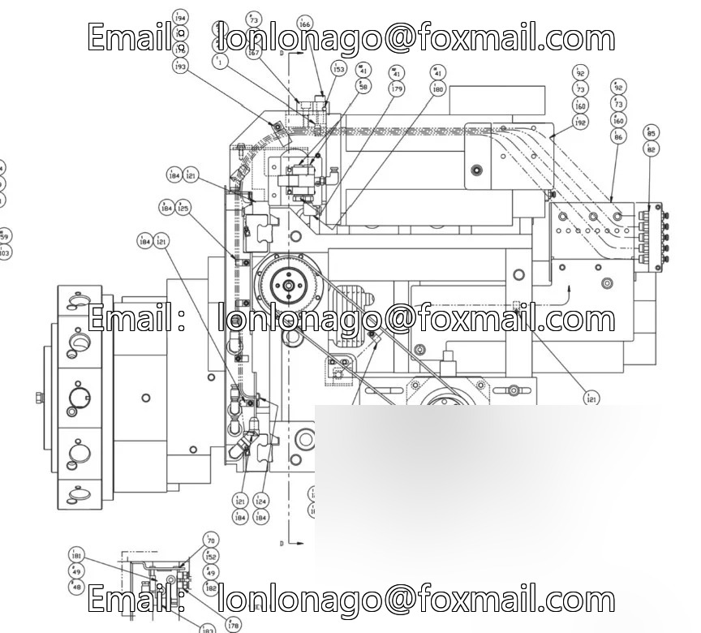
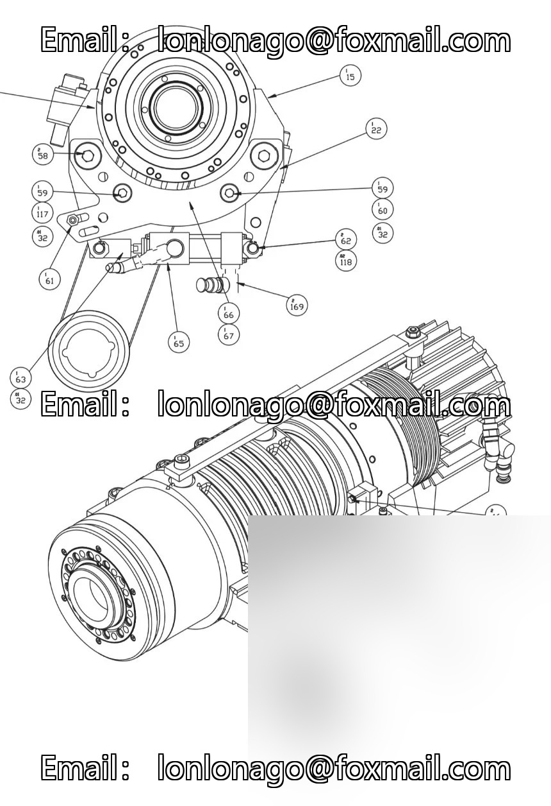
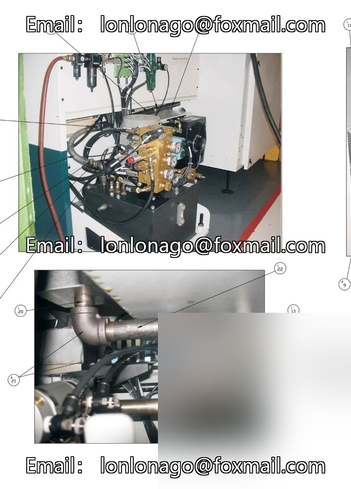
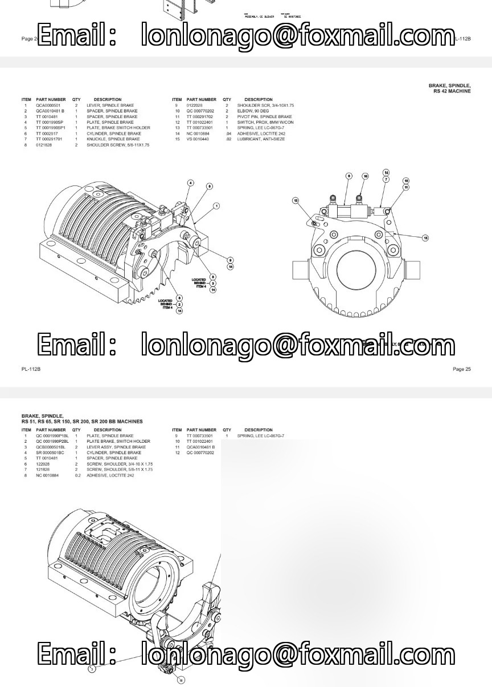
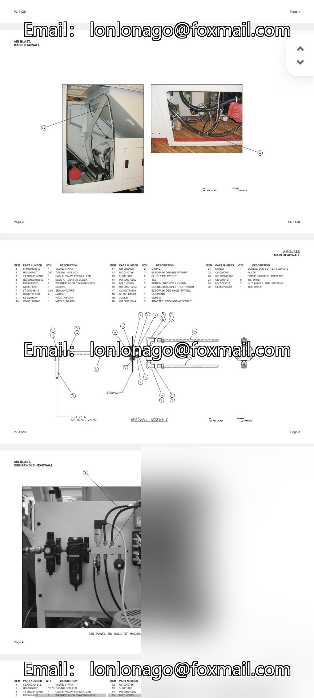

# Hardinge RS series and SR series multi-function CN

## Body

Hardinge RS series and SR series multi-function CNC part list (PDF electronic file, 280 pages)
1. Specific model covered

This manual covers multiple main cutting centers models under Hating, divided into two major factions:

RS Series: RS 42, RS 51, RS 65

SR Series: SR 150, SR 200, SR 200 Big Bore
(Note: "Big Bore" in the model refers to a large bore, typically used for machining thicker stock or performing heavy cutting.)

2. Core highlights: Multi-Tasking Machine Turning

The document title strongly emphasizes "MULTI-TASKING" (multifunction/multi-component processing).

This means that these machines are not merely traditional lathes, and they typically are equipped with:

Y axis: allows the tool to move in a direction perpendicular to the spindle axis, thereby achieving eccentric machining, milling flattening position, drilling, and thread drilling.

Live Tooling (Power Tooling): The tools on the tooling can rotate and perform milling operations, similar to a computerized machining center.
This design greatly reduces the number of clamping operations for workpieces, improving processing accuracy and efficiency.

3. CNC Control

The series machine tools support three high-end numerical control systems and provide flexible automation options.

GE Fanuc 18i-T / 21i-T: This is the classic Fanuc numerical control system, widely used in the machining field, and "T" represents the machining function.

Siemens SINUMERIK 840D SL: This is Siemens' top open CNC system, featuring extremely high processing speed and graphical interface, often used for highly complex surface machining.

4. Equipment application scenarios

RS/SR series machines are designed for the machining of complex parts with high precision and high efficiency. They are widely applied in the aerospace, energy, medical, and automotive high-performance parts industries. Whether for disc parts, axis parts, or asymmetrical rotation parts, this equipment can complete various operations such as turning, milling, drilling, and tapping through a single clamping.
42371

The manual covers Hardinge RS and SR multifunction CNC parts lists, totaling 280 pages; it details model categories, key highlights, CNC controls and application scenarios.

<!-- AI_ENRICHED -->

## Images

## Payment

Here is a pay link on Stripe ( https://buy.stripe.com/3cs8yP7sY87d0vu9AB ). Please contact me lonlonago@foxmail.com after funding $89, and I will send you a complete data files , thank you!

